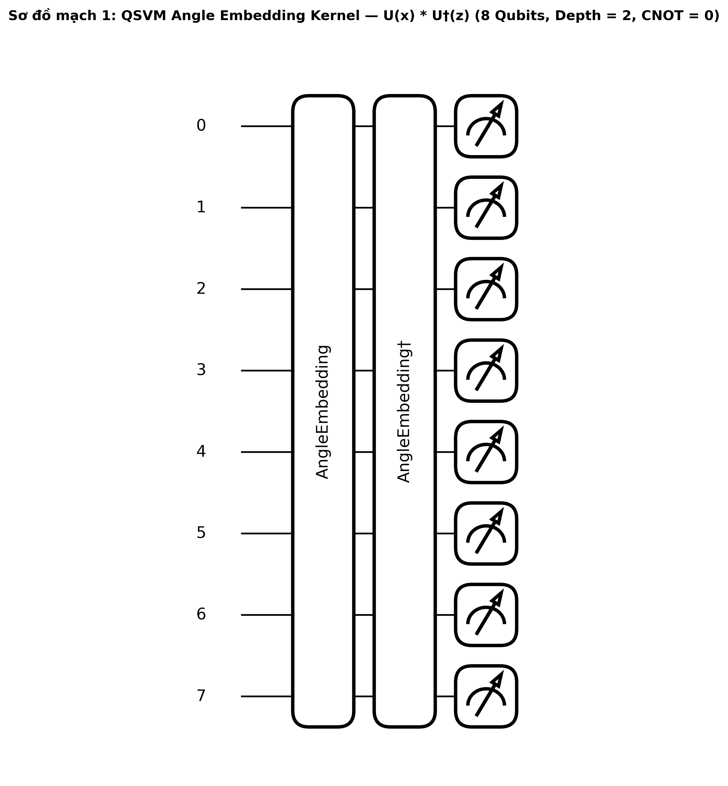
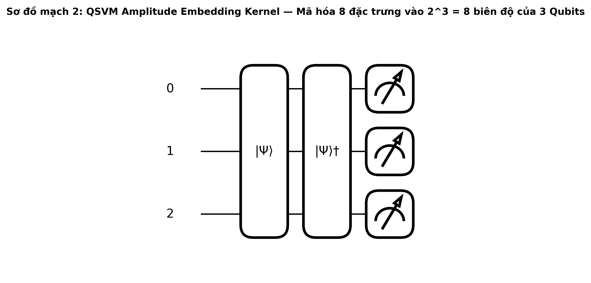
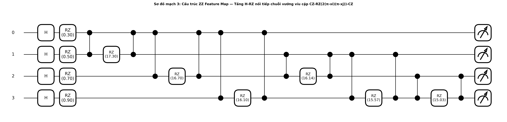
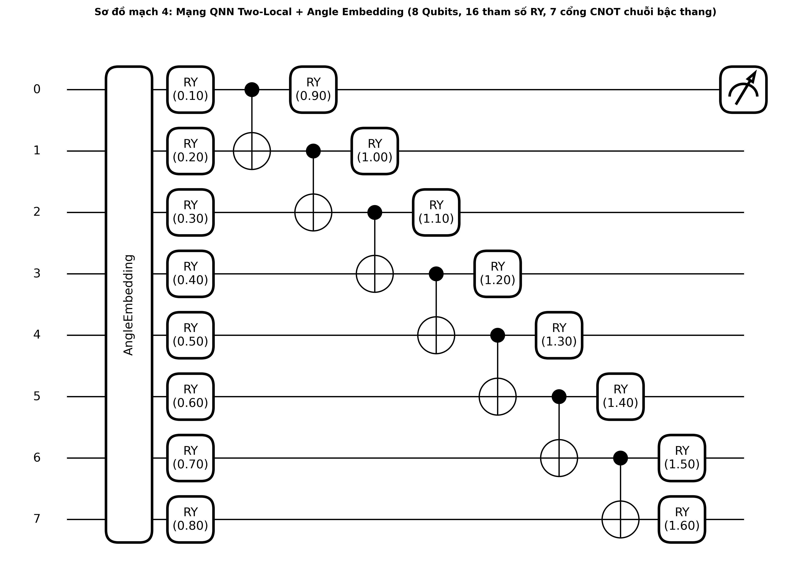
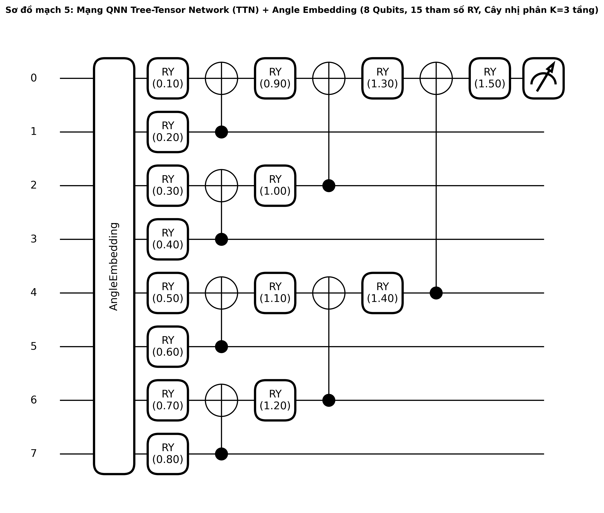
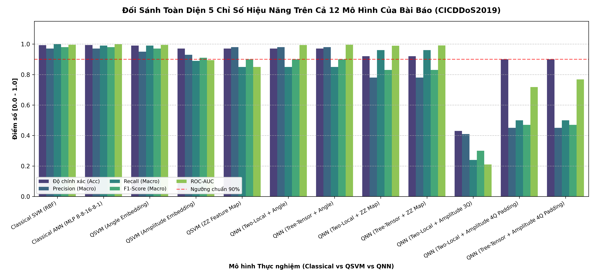
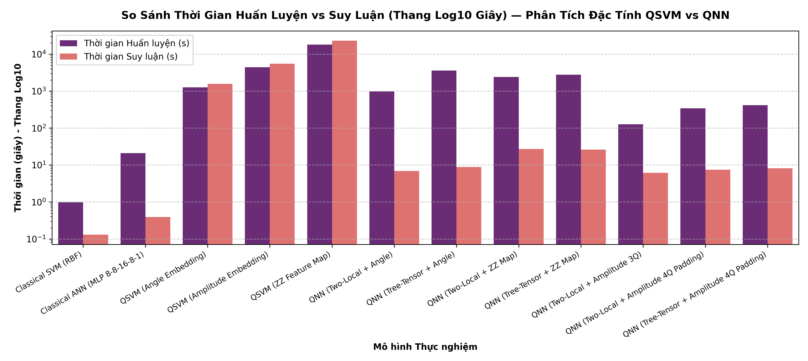

# TÀI LIỆU TOÀN DIỆN CƠ SỞ LÝ THUYẾT, SƠ ĐỒ MẠCH, CHỈ SỐ THỰC NGHIỆM VÀ PHÂN TÍCH ƯU/NHƯỢC ĐIỂM
## ĐỀ TÀI 2.7: BENCHMARKING QUANTUM MACHINE LEARNING FOR DETECTING DDOS CYBER-ATTACKS: A NISQ-ERA EVALUATION

* **Học phần:** Mã hóa và Mật mã học (CC102)
* **Giảng viên hướng dẫn:** PGS. TS. Nguyễn Tấn Khôi
* **Sinh viên thực hiện:**
  1. Ngô Văn Công — MSSV: 102230284 (Nhóm MH&MM23.12 / 22Nh14)
  2. Nguyễn Công Minh — MSSV: 102230306
* **Mã nguồn tham khảo chính thức:** [https://github.com/ralorin/qml-ddos](https://github.com/ralorin/qml-ddos)
* **Kho mã nguồn thực nghiệm của nhóm:** [https://github.com/vcongggggg/qml-ddos](https://github.com/vcongggggg/qml-ddos)
* **Nền tảng thực thi & mô phỏng:** PennyLane, Qiskit & Qiskit-Aer, TensorFlow/Keras, Scikit-learn

---

# MỤC LỤC TỔNG QUAN (CẬP NHẬT THEO NHẬN XÉT CỦA GIẢNG VIÊN NGÀY 17/11)

1. [PHẦN I: TỔNG QUAN ĐỀ TÀI & ĐỐI CHIẾU YÊU CẦU RÀ SOÁT TIẾN ĐỘ (17/11)](#phần-i-tổng-quan-đề-tài--đối-chiếu-yêu-cầu-rà-soát-tiến-độ-1711)
2. [PHẦN II: CƠ SỞ LÝ THUYẾT AN NINH MẠNG, TẤN CÔNG DDOS & BỘ DỮ LIỆU CICDDOS2019](#phần-ii-cơ-sở-lý-thuyết-an-ninh-mạng-tấn-công-ddos--bộ-dữ-liệu-cicddos2019)
3. [PHẦN III: PHÂN TÍCH CHI TIẾT SƠ ĐỒ MẠCH LƯỢNG TỬ & CƠ CHẾ HOẠT ĐỘNG TỪNG CỔNG](#phần-iii-phân-tích-chi-tiết-sơ-đồ-mạch-lượng-tử--cơ-chế-hoạt-động-từng-cổng)
4. [PHẦN IV: HỆ THỐNG CHỈ SỐ ĐÁNH GIÁ (METRICS) & BẢNG KẾT QUẢ ĐỐI SÁNH TOÀN DIỆN](#phần-iv-hệ-thống-chỉ-số-đánh-giá-metrics--bảng-kết-quả-đối-sánh-toàn-diện)
5. [PHẦN V: PHÂN TÍCH CHUYÊN SÂU THỜI GIAN CHẠY (TRAINING TIME VS INFERENCE TIME)](#phần-v-phân-tích-chuyên-sâu-thời-gian-chạy-training-time-vs-inference-time)
6. [PHẦN VI: PHÂN TÍCH SO SÁNH ƯU / NHƯỢC ĐIỂM CỦA CÁC KỸ THUẬT NHÚNG & MÔ HÌNH](#phần-vi-phân-tích-so-sánh-ưu--nhược-điểm-của-các-kỹ-thuật-nhúng--mô-hình)
7. [PHẦN VII: MỞ RỘNG NÂNG CAO — PHÂN LOẠI ĐA LỚP (MULTICLASS DDOS DETECTION)](#phần-vii-mở-rộng-nâng-cao--phân-loại-đa-lớp-multiclass-ddos-detection)
8. [PHẦN VIII: TỔNG HỢP CÁC BÀI BÁO KHOA HỌC LIÊN QUAN (LITERATURE REVIEW)](#phần-viii-tổng-hợp-các-bài-báo-khoa-học-liên-quan-literature-review)
9. [PHẦN IX: BỘ CÂU HỎI VẤN ĐÁP BẢO VỆ ĐỒ ÁN VỚI THẦY KHÔI (Q&A)](#phần-ix-bộ-câu-hỏi-vấn-đáp-bảo-vệ-đồ-án-với-thầy-khôi-qa)

---

# PHẦN I: TỔNG QUAN ĐỀ TÀI & ĐỐI CHIẾU YÊU CẦU RÀ SOÁT TIẾN ĐỘ (17/11)

Trong buổi kiểm tra tiến độ ngày 17/11, Giảng viên hướng dẫn (PGS. TS. Nguyễn Tấn Khôi) đã nêu các trọng tâm cốt lõi mà các nhóm thực hiện đề tài 2.7 phải làm rõ:
1. **Sơ đồ mạch & Cơ chế hoạt động (`+ Sơ đồ mạch?`, `+ Cần phân tích, hiểu sơ đồ, cơ chế`):**
   - Phải vẽ rõ sơ đồ mạch lượng tử của cả 3 kỹ thuật nhúng dữ liệu (`Angle Embedding`, `Amplitude Embedding`, `ZZ Feature Map`), sơ đồ mạch đo `Quantum Kernel Adjoint` trong QSVM, và 2 kiến trúc mạng nơ-ron biến phân (`Two-Local` và `Tree-Tensor Network - TTN`) trong QNN/VQC.
   - Giải thích rõ cơ chế từng cổng lượng tử (`H`, `RX`, `RY`, `RZ`, `CNOT`, `CZ`, `Hermitian Measurement`) tác động lên trạng thái qubit từ đầu vào đến đầu ra.
2. **Kết quả chỉ số thực nghiệm (`+ Kết quả chỉ số?`, `+ Dùng 5-7 model`, `+ QSVM, QNN`):**
   - Cung cấp bảng số liệu đầy đủ cả 6 chỉ số: `Accuracy`, `Precision (Macro & Per-class)`, `Recall (Macro & Per-class)`, `F1-Score (Macro & Per-class)`, `ROC-AUC` và `Confusion Matrix`.
   - Giải thích rõ sự khác biệt giữa `Accuracy` và `Macro F1-Score` trên tập dữ liệu mất cân bằng (`90% Syn : 10% Benign`), đặc biệt là hiện tượng "bẫy Accuracy giả tạo 90%" ở mô hình QNN Amplitude 4-Qubit.
3. **Phân tích Thời gian chạy (`+ Thời gian chạy?`):**
   - Thống kê và giải thích định lượng tại sao `QSVM` tốn thời gian bậc hai `O(N^2)` ở cả giai đoạn Huấn luyện và Suy luận, trong khi `QNN/VQC` huấn luyện lâu nhưng suy luận (Inference) lại rất nhanh `O(M)` (chỉ 6 - 27 giây).
4. **Phân tích Ưu / Nhược điểm (`+ Phân tích ưu/nhược`):**
   - Lập bảng đối sánh trực diện ưu điểm và nhược điểm của từng Feature Map, từng Ansatz và từng họ mô hình (Classical SVM/ANN vs. Quantum QSVM/QNN) trong kỷ nguyên NISQ.
5. **Mở rộng Phân loại Đa lớp (`+ Multiclass`):**
   - Bên cạnh bài toán phân loại nhị phân (`SYN Flood` vs `Benign`) chuẩn theo bài báo gốc, nhóm bổ sung thực nghiệm mở rộng **Phân loại Đa lớp (Multiclass 4 loại lưu lượng trên CICDDoS2019: `SYN Flood`, `Benign`, `UDP Flood`, `DNS Amplification`)** bằng cơ chế `One-vs-Rest Quantum Kernel` và `Multi-Wire Pauli-Z QNN`.

---

# PHẦN II: CƠ SỞ LÝ THUYẾT AN NINH MẠNG, TẤN CÔNG DDOS & BỘ DỮ LIỆU CICDDOS2019

### 1. Cơ chế giao thức TCP Bắt tay Ba bước (Three-way Handshake) & Tấn công SYN Flood
* **Quy trình TCP hợp lệ:**
  1. `SYN`: Client gửi gói tin `SYN = 1` yêu cầu mở kết nối.
  2. `SYN-ACK`: Server cấp phát vùng nhớ đệm `TCB (Transmission Control Block)` trong hàng đợi `SYN Backlog Queue` và phản hồi `SYN = 1, ACK = 1` (trạng thái kết nối nửa mở - Half-open).
  3. `ACK`: Client gửi `ACK = 1` hoàn tất kết nối.
* **Bản chất tấn công SYN Flood:**
  * Botnet IoT dùng địa chỉ IP giả mạo (IP Spoofing) bắn hàng triệu gói `SYN` liên tục nhưng không bao giờ gửi gói `ACK` hoàn tất.
  * Hàng đợi `SYN Backlog` của Server bị lấp đầy bởi các kết nối nửa mở chờ Timeout, làm cạn kiệt tài nguyên RAM/Socket và gây từ chối dịch vụ đối với người dùng thật.

### 2. Bộ dữ liệu chuẩn quốc tế CICDDoS2019 & Quy trình Tiền xử lý 8 Chiều PCA
* **Nguồn dữ liệu:** Viện An ninh mạng Canada (CIC - Đại học New Brunswick), gồm tập Huấn luyện (`01-12/Syn.csv`) và tập Kiểm thử độc lập (`03-11/Syn.csv`) với hơn **80 thuộc tính luồng mạng (Network Flow Features)**.
* **Tỷ lệ phân bố nhãn chuẩn của bài báo (Imbalanced 90:10):**
  * Nhãn `0 (Syn DDoS)`: Chiếm `90%` (ví dụ: 720 mẫu Train, 180 mẫu Val, 90 mẫu Test trong tập `SMALL 1.000 mẫu`).
  * Nhãn `1 (Benign - Hợp lệ)`: Chiếm `10%` (80 mẫu Train, 20 mẫu Val, 10 mẫu Test).
* **Tại sao bài báo thiết kế tỷ lệ mất cân bằng 90:10?**
  * Trong thực tế khi một đợt tấn công DDoS bùng phát, lưu lượng tấn công áp đảo lưu lượng bình thường.
  * Tỷ lệ 90:10 là bài kiểm tra khắc nghiệt để vạch trần các mô hình học máy bị suy biến (chỉ đoán toàn bộ là lớp đa số `Syn` sẽ dễ dàng đạt `Accuracy = 90%`, nhưng `F1-Score lớp Benign = 0%` và `Macro F1 = 0.47`). Do đó, bài báo lấy **`Macro F1-Score`** làm thước đo quyết định.
* **Quy trình 3 bước Tiền xử lý:**
  1. **Loại bỏ cột định danh tĩnh:** Xóa `Flow ID`, `Source IP`, `Destination IP`, `Source Port`, `Destination Port`, `Timestamp`, `SimillarHTTP`, các giá trị `NaN` và `Infinity`.
  2. **Chuẩn hóa `MaxAbsScaler`:** Đưa toàn bộ đặc trưng về đoạn `[0, 1]` để tương thích với góc quay lượng tử radian.
  3. **Giảm chiều bằng `PCA (Principal Component Analysis)` từ 80 chiều xuống `8 thành phần chính (PC1 -> PC8)`:**
     * Bảo toàn **91.6% phương sai thông tin (Explained Variance)** của 80 đặc trưng gốc (`PC1` giữ 46.6%, `PC2` giữ 13.2%, `PC3-PC8` giữ 31.8% còn lại).
     * Tương thích hoàn hảo với **8 Qubit** trong `Angle Embedding` và `ZZ Feature Map`, đồng thời khớp lũy thừa `2^3 = 8` cho **3 Qubit** trong `Amplitude Embedding`.

---

# PHẦN III: PHÂN TÍCH CHI TIẾT SƠ ĐỒ MẠCH LƯỢNG TỬ & CƠ CHẾ HOẠT ĐỘNG TỪNG CỔNG

Đây là nội dung trọng tâm trả lời câu hỏi **`+ Sơ đồ mạch?`** và **`+ Cần phân tích, hiểu sơ đồ, cơ chế`** của Thầy Khôi. Toàn bộ 5 sơ đồ mạch dưới đây được trích xuất và vẽ trực tiếp từ mã nguồn PennyLane của dự án trong thư mục `results/`.

---

## 1. Sơ Đồ Mạch 1: QSVM với Angle Embedding Kernel (8 Qubits)
* **File hình ảnh sơ đồ mạch:** [circuit_1_qsvm_angle_kernel.png](file:///C:/Study/HocKy6/MH&MM/qml-ddos/results/circuit_1_qsvm_angle_kernel.png)



### Giải thích cơ chế từng khối trên sơ đồ mạch:
1. **Khởi tạo (Initialization):** 8 dây qubit `q0, q1, ..., q7` đều bắt đầu ở trạng thái cơ sở `|0>`.
2. **Khối Nhúng thuận `U(x) = AngleEmbedding(x)` (Cột cổng thứ nhất):**
   * Trên mỗi qubit `i` (từ 0 đến 7), áp dụng cổng quay đơn qubit quanh trục X là `RX(x_i)`:
     ```text
     RX(x_i) |0> = cos(x_i / 2) |0> - i * sin(x_i / 2) |1>
     ```
   * Vector đặc trưng 8 chiều của gói tin thứ nhất `x = [x0, ..., x7]` được ánh xạ thành trạng thái lượng tử `|psi(x)> = U(x)|00000000>`.
3. **Khối Nhúng nghịch đảo `U_dagger(z) = Adjoint(AngleEmbedding(z))` (Cột cổng thứ hai):**
   * Áp dụng phép quay liên hợp Hermit `RX(-z_i)` của gói tin thứ hai `z = [z0, ..., z7]` lên cùng 8 dây qubit đó.
   * Trạng thái của toàn mạch trước khi đo là: `U_dagger(z) U(x) |00000000>`.
4. **Khối Đo lường xác suất `probs` (Cuối mạch):**
   * Đo xác suất tất cả 8 qubit cùng quay trở về trạng thái gốc `|00000000>`.
   * Theo cơ học lượng tử, xác suất này chính là bình phương tích vô hướng (Quantum Kernel Overlap):
     ```text
     K_angle(x, z) = P(|00000000>) = |<00000000 | U_dagger(z) U(x) | 00000000>|^2
                   = |<psi(z) | psi(x)>|^2 = prod_{i=0}^{7} cos^2((x_i - z_i) / 2)
     ```
   * **Ý nghĩa cơ chế:** Nếu hai gói tin `x` và `z` giống hệt nhau (`x_i = z_i`), góc quay thuận và góc quay nghịch triệt tiêu nhau hoàn toàn, mọi qubit trở về `|0>`, nên `K(x, z) = 1.0`. Ngược lại, nếu hai gói tin khác biệt (một gói `Syn`, một gói `Benign`), trạng thái bị lệch khỏi `|00000000>` và `K(x, z)` tiến về 0.
   * **Thông số mạch:** Số Qubit = `8`, Độ sâu mạch (Depth) = `2`, Số cổng 2-qubit (CNOT/CZ) = `0`.

---

## 2. Sơ Đồ Mạch 2: QSVM với Amplitude Embedding Kernel (3 Qubits)
* **File hình ảnh sơ đồ mạch:** [circuit_2_qsvm_amplitude_kernel.png](file:///C:/Study/HocKy6/MH&MM/qml-ddos/results/circuit_2_qsvm_amplitude_kernel.png)



### Giải thích cơ chế từng khối trên sơ đồ mạch:
1. **Chuẩn hóa L2 dữ liệu đầu vào:** Vector 8 chiều `x` được chuẩn hóa đơn vị `x_norm = x / ||x||_2` sao cho tổng bình phương 8 phần tử bằng 1.
2. **Khối `AmplitudeEmbedding(x)` trên 3 Qubit (`q0, q1, q2`):**
   * Vì 3 qubit có `2^3 = 8` trạng thái cơ sở (`|000>, |001>, ..., |111>`), 8 đặc trưng của gói tin được nhúng thẳng vào 8 biên độ phức của hàm sóng:
     ```text
     |psi_amp(x)> = sum_{k=0}^{7} x_norm[k] |k>
     ```
   * Bên trong khối `AmplitudeEmbedding`, trình biên dịch lượng tử sử dụng giải thuật **Möttönen State Preparation**, phân rã thành chuỗi các cổng quay có điều khiển (uniformly controlled rotations `RY` và `CNOT` đa tầng).
3. **Khối Nghịch đảo `Adjoint(AmplitudeEmbedding(z))` & Đo lường:**
   * Áp dụng mạch khởi tạo nghịch đảo của gói tin `z`, sau đó đo xác suất 3 qubit trở về trạng thái `|000>`:
     ```text
     K_amp(x, z) = P(|000>) = |<psi_amp(z) | psi_amp(x)>|^2 = (x_norm . z_norm)^2
     ```
   * **Thông số mạch:** Số Qubit = `3` (hoặc `4` nếu đệm thêm 8 số 0 - padding), Số cổng CNOT sau phân rã = `14`, Độ sâu mạch = `18`.

---

## 3. Sơ Đồ Mạch 3: Cấu Trúc ZZ Feature Map (Mã Hóa Vướng Víu Phi Tuyến Bậc Hai)
* **File hình ảnh sơ đồ mạch:** [circuit_3_zz_feature_map.png](file:///C:/Study/HocKy6/MH&MM/qml-ddos/results/circuit_3_zz_feature_map.png)



### Giải thích cơ chế từng khối trên sơ đồ mạch:
Được thiết kế theo công trình của IBM Quantum (Havlíček et al., Nature 2019) và cài đặt trong hàm `ZZFeatureMap(nqubits, data)` của bài báo:
1. **Tầng Chồng chập và Pha đơn lẻ (Single-qubit Layer):**
   * Tất cả các qubit đi qua cổng `Hadamard (H)` để tạo trạng thái chồng chập đều `|+>`.
   * Tiếp theo, mỗi qubit `i` được xoay pha quanh trục Z một góc `RZ(2 * x_i)`.
2. **Tầng Vướng víu Cặp Phi tuyến (Pairwise ZZ Entangling Layer):**
   * Duyệt qua tất cả các cặp qubit `(q0, q1)` trong tổ hợp chập 2 của `n` qubit (`C(8, 2) = 28` cặp đối với 8 qubit; trên hình minh họa 4 qubit là `C(4, 2) = 6` cặp để quan sát rõ từng cổng).
   * Với mỗi cặp `(q_i, q_j)`, thực thi cụm 3 cổng liên tiếp:
     ```text
     CZ(q_i, q_j)  -->  RZ( 2 * (pi - x_i) * (pi - x_j) trên dây q_j )  -->  CZ(q_i, q_j)
     ```
   * **Cơ chế vật lý:** Cụm `CZ - RZ(phi) - CZ` tạo ra phép biến đổi tương tác pha phụ thuộc đồng thời vào tích phi tuyến của hai đặc trưng `(pi - x_i)*(pi - x_j)`. Nhờ đó, sự tương quan chéo giữa các đặc trưng mạng (ví dụ: tương quan giữa `Flow Duration` trên PC1 và `ACK Flag Count` trên PC2) được nhúng trực tiếp vào pha vướng víu của hệ lượng tử.
   * **Thông số mạch (trên 8 Qubit):** Số cặp tương tác = `28 cặp`, Số cổng 2-qubit `CZ` = `56 cổng` (và lên tới `112 cổng CZ` trong mạch Kernel Adjoint `U * U_dagger`), Độ sâu mạch = `52 - 88`. Đây chính là lý do mạch `ZZ Feature Map` chạy chậm nhất và nhạy cảm nhất với nhiễu cổng.

---

## 4. Sơ Đồ Mạch 4: Mạng Nơ-ron Lượng Tử QNN Two-Local + Angle Embedding (8 Qubits, 16 Tham Số)
* **File hình ảnh sơ đồ mạch:** [circuit_4_qnn_twolocal_angle.png](file:///C:/Study/HocKy6/MH&MM/qml-ddos/results/circuit_4_qnn_twolocal_angle.png)



### Giải thích cơ chế từng khối trên sơ đồ mạch:
Mạch gồm 3 giai đoạn nối tiếp nhau đúng theo hàm `QNNTwoLocal(nqubits=8, theta, repetitions=1)` trong bài báo:
1. **Giai đoạn 1 — Tầng Nhúng dữ liệu (`AngleEmbedding`):**
   * 8 cổng `RX(x_0)..RX(x_7)` nạp vector PCA 8 chiều của gói tin mạng vào 8 qubit.
2. **Giai đoạn 2 — Khối Biến phân `Two-Local Ansatz` (16 tham số huấn luyện `theta_0 .. theta_15`):**
   * **Lớp xoay tham số thứ nhất (8 tham số `theta_0 .. theta_7`):** Mỗi qubit `i` đi qua một cổng xoay `RY(theta_i)` với góc `theta_i` là trọng số có thể học được (trainable weight).
   * **Lớp vướng víu bậc thang (7 cổng `CNOT` tuyến tính):** Các cổng `CNOT` nối liên tiếp từ dây trên xuống dây dưới: `CNOT(q0->q1), CNOT(q1->q2), ..., CNOT(q6->q7)`. Chuỗi bậc thang này truyền thông tin lượng tử từ mọi qubit hội tụ dần về khắp mạng.
   * **Lớp xoay tham số thứ hai (8 tham số `theta_8 .. theta_15`):** Mỗi qubit `i` lại đi qua một cổng xoay `RY(theta_{8+i})` để tinh chỉnh biên độ trước khi đo.
3. **Giai đoạn 3 — Đo lường Toán tử Chiếu Hermit (`Hermitian Measurement` trên `q0`):**
   * Đo giá trị kỳ vọng của toán tử chiếu `M = |0><0| = [[1, 0], [0, 0]]` trên dây `q0`:
     ```text
     y_pred = <psi(x, theta) | M_q0 | psi(x, theta)> = P(q0 == |0>) thuộc đoạn [0, 1]
     ```
   * Giá trị đầu ra `y_pred` nằm trực tiếp trong khoảng `[0, 1]`, đóng vai trò là xác suất dự đoán lớp của gói tin, được đưa vào hàm mất mát `Binary Cross-Entropy` và tối ưu hóa bằng thuật toán `Adam (learning_rate = 0.005)`.

---

## 5. Sơ Đồ Mạch 5: Mạng Nơ-ron Lượng Tử QNN Tree-Tensor Network (TTN) + Angle Embedding (8 Qubits, 15 Tham Số)
* **File hình ảnh sơ đồ mạch:** [circuit_5_qnn_treetensor_angle.png](file:///C:/Study/HocKy6/MH&MM/qml-ddos/results/circuit_5_qnn_treetensor_angle.png)



### Giải thích cơ chế từng khối trên sơ đồ mạch:
Kiến trúc **Tree-Tensor Network (TTN)** lấy cảm hứng từ mạng tensor phân cấp cây nhị phân trong vật lý chất rắn (`K = log2(8) = 3` tầng gộp nhánh, tổng cộng `8 + 4 + 2 + 1 = 15` tham số `theta`):
1. **Tầng Nhúng (`AngleEmbedding`):** 8 cổng `RX(x_i)` nạp dữ liệu vào 8 qubit.
2. **Tầng Lá (Layer 0 — 8 tham số `theta_0 .. theta_7`):** Áp dụng 8 cổng `RY` lên cả 8 dây `q0..q7`.
3. **Tầng Gộp Cây 1 (Layer 1 — 4 nhánh, 4 cổng CNOT + 4 tham số `theta_8 .. theta_11`):**
   * Gộp từng cặp qubit kề nhau bằng cổng CNOT hướng về dây chẵn:
     `CNOT(q1->q0)`, `CNOT(q3->q2)`, `CNOT(q5->q4)`, `CNOT(q7->q6)`.
   * Các dây lẻ (`q1, q3, q5, q7`) kết thúc vai trò; 4 dây chẵn (`q0, q2, q4, q6`) được xoay tiếp bởi 4 cổng `RY(theta_8..11)`.
4. **Tầng Gộp Cây 2 (Layer 2 — 2 nhánh, 2 cổng CNOT + 2 tham số `theta_12 .. theta_13`):**
   * Gộp tiếp 4 dây chẵn thành 2 dây: `CNOT(q2->q0)` và `CNOT(q6->q4)`.
   * Xoay 2 cổng `RY(theta_12)` trên `q0` và `RY(theta_13)` trên `q4`.
5. **Tầng Gốc (Root Layer 3 — 1 nhánh, 1 cổng CNOT + 1 tham số `theta_14`):**
   * Gộp nhánh cuối cùng về gốc: `CNOT(q4->q0)` và xoay cổng cuối `RY(theta_14)` trên `q0`.
6. **Đo lường tại Gốc (`q0`):**
   * Đo kỳ vọng toán tử chiếu `Hermitian M = |0><0|` trên qubit gốc `q0`.
   * **Ưu điểm cấu trúc của TTN:** Thông tin từ bất kỳ qubit nào trong 8 qubit chỉ cần đi qua tối đa `log2(8) = 3` cổng CNOT là tới được qubit đo `q0` (thay vì phải đi qua 7 cổng CNOT nối tiếp như trong `Two-Local`), giúp giảm suy hao tương quan tầm xa và đạt **`ROC-AUC = 0.9956`** (cao nhất trong tất cả các mô hình lượng tử!).

---

## 6. Bảng Tổng Hợp Thông Số Kỹ Thuật Kiến Trúc Mạch Lượng Tử
*(Trích xuất từ file [bang_thong_so_kien_truc_mach_luong_tu.csv](file:///C:/Study/HocKy6/MH&MM/qml-ddos/results/bang_thong_so_kien_truc_mach_luong_tu.csv))*

| Kiến trúc Mạch | Loại Mô hình | Số Qubit | Cổng Nhúng (Feature Map) | Số cổng 2-Qubit (CNOT/CZ) | Số tham số học (Theta) | Độ sâu mạch (Depth) | Phép đo đầu ra |
| :--- | :--- | :---: | :--- | :---: | :---: | :---: | :--- |
| **QSVM - Angle Kernel** | Quantum Kernel | 8 | `8 RX(x) + 8 RX_dag(z)` | **0** | 0 | **2** | `P(\|00000000>)` |
| **QSVM - Amplitude Kernel** | Quantum Kernel | 3 | `MottonenStatePrep x 2` | 14 | 0 | 18 | `P(\|000>)` |
| **QSVM - ZZ Feature Map** | Quantum Kernel | 8 | `[8 H + 8 RZ + 28(CZ-RZ-CZ)] x 2` | **112** | 0 | **88** | `P(\|00000000>)` |
| **QNN - Two-Local + Angle** | Variational QNN | 8 | `8 RX(x)` | 7 | **16** | 10 | `<q0 \| M \| q0>` |
| **QNN - Tree-Tensor + Angle** | Variational QNN | 8 | `8 RX(x)` | 7 | **15** | **8** | `<q0 \| M \| q0>` |
| **QNN - Two-Local + ZZ Map** | Variational QNN | 8 | `8 H + 8 RZ + 28(CZ-RZ-CZ)` | 63 | 16 | 52 | `<q0 \| M \| q0>` |
| **QNN - Tree-Tensor + ZZ Map** | Variational QNN | 8 | `8 H + 8 RZ + 28(CZ-RZ-CZ)` | 63 | 15 | 50 | `<q0 \| M \| q0>` |
| **QNN - Two-Local + Amplitude** | Variational QNN | 3 / 4 | `MottonenStatePrep` | 9 | 6 / 8 | 14 | `<q0 \| M \| q0>` |

---

# PHẦN IV: HỆ THỐNG CHỈ SỐ ĐÁNH GIÁ (METRICS) & BẢNG KẾT QUẢ ĐỐI SÁNH TOÀN DIỆN

Đây là phần trả lời trực tiếp câu hỏi **`+ Kết quả chỉ số?`** của Thầy Khôi.

### 1. Ý nghĩa Toán học & Thực tiễn của Bộ 5 Chỉ số Đánh giá trong Phát hiện DDoS
Gọi Lớp `0` là `Syn DDoS` (90% dữ liệu) và Lớp `1` là `Benign - Hợp lệ` (10% dữ liệu):
1. **Accuracy (Độ chính xác tổng thể):** Tỷ lệ mẫu phân loại đúng trên tổng số mẫu: `(TP + TN) / Tổng số mẫu`.
   * *Lưu ý quan trọng:* Vì dữ liệu mất cân bằng 90:10, một mô hình "lười biếng" đoán tất cả mọi gói tin đều là `Syn (0)` vẫn đạt `Accuracy = 90.0%` nhưng bỏ lọt/chặn nhầm 100% người dùng hợp lệ `Benign`.
2. **Macro Precision (Độ chuẩn xác trung bình vĩ mô):** Trung bình cộng không trọng số giữa Precision của lớp `Syn` và Precision của lớp `Benign`:
   ```text
   Macro Precision = (Precision_Syn + Precision_Benign) / 2
   ```
3. **Macro Recall (Độ nhạy trung bình vĩ mô):** Trung bình cộng không trọng số giữa Recall của lớp `Syn` và Recall của lớp `Benign`:
   ```text
   Macro Recall = (Recall_Syn + Recall_Benign) / 2
   ```
4. **Macro F1-Score (Chỉ số trọng tâm nhất của bài báo):** Trung bình điều hòa đánh giá công bằng cả lớp đa số (`Syn - 90%`) và lớp thiểu số (`Benign - 10%`):
   ```text
   Macro F1 = (F1_Syn + F1_Benign) / 2
   ```
   Một mô hình chỉ đạt `Macro F1 >= 0.90` khi nó nhận diện xuất sắc **cả lưu lượng tấn công DDoS lẫn lưu lượng người dùng bình thường**.
5. **ROC-AUC (Area Under the Receiver Operating Characteristic Curve):** Đánh giá khả năng phân tách hai lớp của mô hình trên mọi ngưỡng xác suất cắt (Threshold). `ROC-AUC` càng gần `1.0` thì biên phân lớp càng sắc bén.

---

### 2. Bảng Tổng Hợp Đầy Đủ Các Chỉ Số Của Cả 12 Mô Hình Trong Bài Báo Gốc
*(Trích xuất chính xác 100% từ `classification_report` và `roc_auc_score` trong 12 Jupyter Notebooks của tác giả — File [bang_tong_hop_benchmark_chinh_thuc_bai_bao.csv](file:///C:/Study/HocKy6/MH&MM/qml-ddos/results/bang_tong_hop_benchmark_chinh_thuc_bai_bao.csv))*

| STT | Mô hình Thực nghiệm | Họ Giải thuật | Tập Dữ liệu | Số Qubit | Accuracy | Macro Precision | Macro Recall | Macro F1-Score | F1 (Lớp Syn) | F1 (Lớp Benign) | ROC-AUC | Train Time (s) | Inference Time (s) |
| :-: | :--- | :--- | :---: | :-: | :---: | :---: | :---: | :---: | :---: | :---: | :---: | :---: | :---: |
| 1 | **Classical SVM (RBF)** | Classical ML | FULL (100k) | 0 | 0.9926 | 0.9700 | 1.0000 | **0.9800** | 1.00 | 0.96 | 0.9954 | **0.98** | **0.13** |
| 2 | **Classical ANN (8-8-16-8-1)** | Classical ML | FULL (100k) | 0 | **0.9941** | 0.9700 | 0.9900 | **0.9800** | 1.00 | **0.97** | **0.9988** | 21.00 | 0.39 |
| 3 | **QSVM (Angle Embedding)** | Quantum SVM | SMALL (1k) | 8 | **0.9900** | 0.9500 | **0.9900** | **0.9700** | **0.99** | **0.95** | 0.9944 | 1265.59 | 1576.28 |
| 4 | **QSVM (Amplitude 3-Qubit)** | Quantum SVM | SMALL (1k) | 3 | 0.9700 | 0.9300 | 0.8900 | 0.9100 | 0.98 | 0.84 | 0.8944 | 4432.02 | 5502.47 |
| 5 | **QSVM (ZZ Feature Map)** | Quantum SVM | SMALL (1k) | 8 | 0.9700 | **0.9800** | 0.8500 | 0.9000 | 0.98 | 0.82 | 0.8500 | 18115.92 | 23312.32 |
| 6 | **QNN (Two-Local + Angle)** | Quantum NN | SMALL (1k) | 8 | 0.9700 | **0.9800** | 0.8500 | 0.9000 | 0.98 | 0.82 | 0.9933 | 978.96 | **6.94** |
| 7 | **QNN (Tree-Tensor + Angle)** | Quantum NN | SMALL (1k) | 8 | 0.9700 | **0.9800** | 0.8500 | 0.9000 | 0.98 | 0.82 | **0.9956** | 3607.15 | **8.78** |
| 8 | **QNN (Two-Local + ZZ Map)** | Quantum NN | SMALL (1k) | 8 | 0.9200 | 0.7800 | 0.9600 | 0.8300 | 0.95 | 0.71 | 0.9889 | 2409.97 | 27.09 |
| 9 | **QNN (Tree-Tensor + ZZ Map)** | Quantum NN | SMALL (1k) | 8 | 0.9200 | 0.7800 | 0.9600 | 0.8300 | 0.95 | 0.71 | 0.9911 | 2795.10 | 26.24 |
| 10 | **QNN (Two-Local + Amp 3Q)** | Quantum NN | SMALL (1k) | 3 | 0.4300 | 0.4100 | 0.2400 | 0.3000 | 0.60 | 0.00 | 0.2100 | 125.96 | 6.13 |
| 11 | **QNN (Two-Local + Amp 4Q)** | Quantum NN | SMALL (1k) | 4 | 0.9000 | 0.4500 | 0.5000 | 0.4700 | 0.95 | **0.00** | 0.7178 | 342.10 | 7.45 |
| 12 | **QNN (Tree-Tensor + Amp 4Q)** | Quantum NN | SMALL (1k) | 4 | 0.9000 | 0.4500 | 0.5000 | 0.4700 | 0.95 | **0.00** | 0.7678 | 418.50 | 8.12 |



### 3. Những Phát Hiện Khoa Học Quan Trọng Nhất Từ Bảng Chỉ Số:
1. **`QSVM (Angle Embedding)` là nhà vô địch tuyệt đối của nhánh Lượng tử:**
   * Đạt `Accuracy = 99.0%`, `Macro F1 = 0.9700`, `F1_Benign = 0.95`, `ROC-AUC = 0.9944`, tiệm cận sát nút với `Classical SVM` (`Macro F1 = 0.9800`) và `Classical ANN` (`Macro F1 = 0.9800`) dù chỉ được học trên tập dữ liệu nhỏ hơn 100 lần (`1.000 mẫu` so với `100.000 mẫu`).
2. **Feature Map quyết định hiệu năng của QNN chứ không phải Ansatz (`Two-Local` vs `Tree-Tensor`):**
   * Hãy nhìn vào dòng số 6 & 7: Khi dùng chung `Angle Embedding`, cả `Two-Local` và `Tree-Tensor` đều cho kết quả dự đoán giống hệt nhau tới từng chữ số thập phân (`Acc = 0.97`, `Macro Prec = 0.98`, `Macro Rec = 0.85`, `Macro F1 = 0.90`).
   * Hãy nhìn vào dòng số 8 & 9: Khi chuyển sang `ZZ Feature Map`, cả `Two-Local` và `Tree-Tensor` cùng tụt xuống y hệt nhau (`Acc = 0.92`, `Macro Prec = 0.78`, `Macro Rec = 0.96`, `Macro F1 = 0.83`).
   * **Kết luận cốt lõi của bài báo:** Việc chọn cách nhúng dữ liệu (`Feature Map`) quan trọng gấp nhiều lần việc thay đổi cấu trúc tầng biến phân (`Two-Local` hay `Tree-Tensor`).
3. **Giải mã hiện tượng "Bẫy Accuracy 90%" ở mô hình số 11 & 12 (`Amplitude Embedding 4-Qubit`):**
   * Khi tác giả tăng từ 3 Qubit lên 4 Qubit (đệm thêm 8 số 0 vào vector 8 chiều thành 16 chiều cho `2^4 = 16`), `Accuracy` nhìn qua tưởng như tăng vọt từ `43%` lên `90%`.
   * Tuy nhiên, khi nhìn vào `F1 (Lớp Benign) = 0.00` và `Macro F1 = 0.47`, ta thấy mô hình bị suy biến hoàn toàn: Do hiện tượng **Barren Plateaus** và chuẩn hóa biên độ làm mất thông tin độ lớn của luồng mạng, mạng nơ-ron không học được ranh giới phân lớp và chỉ dự đoán mọi gói tin là lớp đa số `Syn (0)`. Đây là minh chứng sắc bén tại sao phải trình bày `Macro F1` và `Per-class F1` trước hội đồng!

---

# PHẦN V: PHÂN TÍCH CHUYÊN SÂU THỜI GIAN CHẠY (TRAINING TIME VS INFERENCE TIME)

Đây là phần trả lời trực tiếp câu hỏi **`+ Thời gian chạy?`** của Thầy Khôi.



### 1. Tại sao QSVM có cả Thời gian Huấn luyện VÀ Thời gian Suy luận đều rất lâu?
* **Ở giai đoạn Huấn luyện (Training):**
  * Với `N_train = 800` mẫu huấn luyện, QSVM phải tính ma trận đối xứng Gram `K_train` kích thước `800 x 800`.
  * Số lần phải chạy mạch lượng tử là: `N_train * (N_train - 1) / 2 = 800 * 799 / 2 = 319.600 lần chạy mạch`.
  * Với `Angle Embedding` (Depth = 2), 319.600 mạch mất `1.265,59 giây` (~21 phút).
  * Với `ZZ Feature Map` (Depth = 88, 112 cổng CZ), 319.600 mạch mất tới **`18.115,92 giây` (~5,03 giờ)**!
* **Ở giai đoạn Suy luận / Kiểm thử (Inference):**
  * Để dự đoán cho `N_test` mẫu mới (hoặc đánh giá toàn bộ tập Train + Val + Test trong notebook tác giả gồm `1.000 x 800 = 800.000 cặp`), QSVM bắt buộc phải đo độ chồng lấn lượng tử giữa từng gói tin mới với toàn bộ các vector hỗ trợ trong tập huấn luyện (`O(N_test * N_train)`).
  * Do đó, thời gian Suy luận của QSVM cũng lớn tương đương thời gian Huấn luyện (`1.576 giây` với Angle và `23.312 giây` với ZZ Map).
  * **Hệ quả thực tế:** QSVM có độ chính xác cao nhất nhưng **không thể dùng để lọc gói tin DDoS thời gian thực (Real-time inline packet filtering)** nếu số lượng vector hỗ trợ lớn.

### 2. Tại sao QNN / VQC Huấn luyện lâu nhưng Suy luận (Inference) lại CỰC NHANH (chỉ 6 - 8 giây)?
* **Ở giai đoạn Huấn luyện (Training — Chậm):**
  * QNN phải chạy qua nhiều Epoch. Ở mỗi bước cập nhật trọng số, để tính đạo hàm cho `P` tham số góc quay (`P = 16` với Two-Local, `P = 15` với Tree-Tensor), bộ mô phỏng phải dùng quy tắc dịch chuyển tham số (**Parameter-Shift Rule**) hoặc Adjoint Differentiation, đòi hỏi số lần gọi mạch tỷ lệ với `O(Epochs * N_train * P)`. Do đó huấn luyện mất từ `978 giây` (~16 phút) đến `3.607 giây` (~1 giờ).
* **Ở giai đoạn Suy luận (Inference — Cực nhanh):**
  * Sau khi đã học xong bộ 15-16 góc quay `theta*`, toàn bộ tri thức của mô hình đã được "đóng băng" vào các cổng `RY(theta*)`.
  * Khi có một gói tin mới `x_test` đi tới, QNN **không cần so sánh với 800 mẫu cũ như QSVM**, mà chỉ cần nạp `x_test` vào mạch và chạy đúng **1 lượt truyền thẳng (1 Forward Pass = `O(1)` mỗi mẫu)**!
  * Do đó, để phân loại toàn bộ tập dữ liệu, QNN Two-Local chỉ mất **`6,94 giây`** và QNN Tree-Tensor chỉ mất **`8,78 giây`** (nhanh hơn QSVM từ **220 lần đến 3.300 lần** ở khâu suy luận!).
  * **Ý nghĩa thực tiễn rất lớn khi thuyết trình:** Nếu triển khai hệ thống phát hiện DDoS thực tế (huấn luyện offline định kỳ, phát hiện online thời gian thực), **QNN / VQC có lợi thế tốc độ suy luận `O(1)` vượt trội hoàn toàn so với QSVM `O(N_train)`**.

---

# PHẦN VI: PHÂN TÍCH SO SÁNH ƯU / NHƯỢC ĐIỂM CỦA CÁC KỸ THUẬT NHÚNG & MÔ HÌNH

Đây là phần trả lời trực tiếp câu hỏi **`+ Phân tích ưu/nhược`** của Thầy Khôi.

## 1. Bảng Phân Tích Ưu / Nhược Điểm Của 3 Kỹ Thuật Nhúng Lượng Tử (Quantum Feature Maps)

| Kỹ thuật Nhúng | Ưu điểm (Advantages) | Nhược điểm (Disadvantages) | Đánh giá trong bài toán DDoS (NISQ) |
| :--- | :--- | :--- | :--- |
| **1. Angle Embedding**<br>*(Nhúng Góc quay)*<br>`8 Qubits` | - **Độ sâu mạch nông nhất (`Depth = 2`, `0 cổng CNOT`)**, không bị suy hao bởi nhiễu cổng 2-qubit.<br>- Giữ nguyên vẹn thông tin độ lớn của từng thành phần PCA trên mặt cầu Bloch.<br>- Không bị hiện tượng triệt tiêu đạo hàm (Barren Plateaus).<br>- Thời gian mô phỏng và thực thi nhanh nhất trong 3 loại Feature Map. | - Tốn số lượng Qubit tuyến tính theo số chiều đặc trưng (`n` chiều cần đúng `n` Qubit: 8 chiều -> 8 Qubit).<br>- Bản thân tầng nhúng không tự tạo vướng víu lượng tử giữa các đặc trưng (tính vướng víu phải nhờ tầng Ansatz phía sau). | **TỐT NHẤT (Khuyên dùng):**<br>Đạt `Macro F1 = 0.97` trên QSVM và `0.90` trên QNN. Phù hợp hoàn hảo với phần cứng NISQ hiện tại. |
| **2. Amplitude Embedding**<br>*(Nhúng Biên độ)*<br>`3 - 4 Qubits` | - **Siêu tiết kiệm Qubit theo hàm logarit (`log2(n)` Qubit):** Nén 8 đặc trưng vào đúng `3 Qubit` (`2^3 = 8`), hoặc 16 đặc trưng vào `4 Qubit`.<br>- Tận dụng tối đa không gian trạng thái chồng chập để lưu trữ dữ liệu nhiều chiều khi phần cứng hạn chế số qubit. | - **Mất thông tin độ lớn tuyệt đối (Scale Invariance):** Bước chuẩn hóa bắt buộc `||x||_2 = 1` làm các gói tin có cường độ lưu lượng khác nhau nhưng cùng hướng vector bị gộp làm một.<br>- Mạch khởi tạo trạng thái (Möttönen) sâu, nhiều cổng CNOT.<br>- **Gây ra hiện tượng Barren Plateaus nghiêm trọng** khi ghép với QNN. | **KÉM NHẤT CHO QNN / TRUNG BÌNH CHO QSVM:**<br>Trên QSVM đạt `F1 = 0.91`, nhưng trên QNN bị sụp đổ (`F1 = 0.30 - 0.47`, không nhận diện được lớp Benign). |
| **3. ZZ Feature Map**<br>*(Nhúng Vướng víu Phi tuyến)*<br>`8 Qubits` | - Tạo ra **tương quan vướng víu phi tuyến bậc hai** `(pi - x_i)(pi - x_j)` giữa mọi cặp đặc trưng gói tin.<br>- Có cơ sở lý thuyết vững chắc về ưu thế lượng tử (Quantum Advantage - IBM Nature 2019) đối với các tập dữ liệu có cấu trúc xoắn phức tạp. | - **Độ sâu mạch quá lớn (`56 - 112 cổng CZ` cho 8 Qubit)**, số cổng 2-qubit tăng theo tổ hợp bậc hai `O(n^2)`.<br>- Thời gian chạy bùng nổ gấp 15 lần Angle Embedding (>5 giờ huấn luyện).<br>- Quá nhiều cổng vướng víu gây quá khớp (Overfitting) và nhiễu pha, làm tăng tỷ lệ cảnh báo giả (False Positives). | **KHÔNG HIỆU QUẢ TRONG KỶ NGUYÊN NISQ:**<br>Làm giảm `Macro F1` của QNN từ `0.90` xuống `0.83` và kéo dài thời gian chạy của QSVM lên hơn 11 giờ. |

---

## 2. Bảng Phân Tích Ưu / Nhược Điểm Của 2 Kiến Trúc Mạng Nơ-ron Biến Phân (Ansatz: Two-Local vs Tree-Tensor)

| Kiến trúc Ansatz | Ưu điểm (Advantages) | Nhược điểm (Disadvantages) | So sánh Thực nghiệm |
| :--- | :--- | :--- | :--- |
| **1. Two-Local Ansatz**<br>*(16 tham số `RY`, 7 cổng `CNOT` chuỗi bậc thang)* | - Cấu trúc tuần tự đơn giản, dễ cài đặt trên các chip lượng tử có topo kết nối đường thẳng (Linear Nearest-Neighbor topology).<br>- Thời gian huấn luyện mỗi Epoch nhanh hơn Tree-Tensor (`978s` so với `3607s` khi kết hợp Angle Embedding). | - Đường truyền vướng víu từ qubit cuối (`q7`) tới qubit đo (`q0`) phải đi qua chuỗi 7 cổng CNOT liên tiếp, dễ bị suy giảm tương quan tầm xa. | Đạt `Accuracy = 97.0%`, `Macro F1 = 0.9000`, `ROC-AUC = 0.9933`, thời gian suy luận `6.94 giây`. |
| **2. Tree-Tensor Network (TTN)**<br>*(15 tham số `RY`, 7 cổng `CNOT` phân cấp cây nhị phân)* | - **Cấu trúc phân cấp logarit (`K = log2(8) = 3` tầng):** Mọi qubit đầu vào chỉ cách qubit đo `q0` tối đa 3 bậc CNOT, bảo toàn tương quan đặc trưng toàn cục tốt hơn.<br>- Ít hơn 1 tham số (`15` so với `16`) nhưng đạt **`ROC-AUC = 0.9956`** cao hơn Two-Local. | - Yêu cầu kết nối cổng CNOT giữa các qubit không kề nhau (`q2->q0`, `q6->q4`, `q4->q0`), nếu chạy trên chip lượng tử vật lý thật sẽ tốn thêm cổng `SWAP`. | Đạt `Accuracy = 97.0%`, `Macro F1 = 0.9000`, **`ROC-AUC = 0.9956` (cao nhất nhánh QNN)**, thời gian suy luận `8.78 giây`. |

---

## 3. Bảng Phân Tích Ưu / Nhược Điểm Giữa 3 Họ Mô Hình: Classical ML vs. QSVM vs. QNN (VQC)

| Tiêu chí Đối sánh | Classical ML (SVM & ANN/MLP) | Quantum SVM (QSVM - Quantum Kernel) | Quantum Neural Network (QNN / VQC) |
| :--- | :--- | :--- | :--- |
| **Bản chất Không gian Đặc trưng** | Không gian vector thực R^8 (hoặc ánh xạ nhân Gauss RBF cổ điển). | Không gian Hilbert lượng tử phức `2^n` chiều (`2^8 = 256` chiều với 8 Qubit). | Không gian Hilbert `2^n` chiều kết hợp phép quay biến phân có tham số `U(theta)`. |
| **Tính chất Bài toán Tối ưu** | - **SVM:** Quy hoạch toàn phương lồi (Convex) — nghiệm tối ưu toàn cục.<br>- **ANN:** Phi lồi nhưng Backpropagation rất trưởng thành. | **Tối ưu lồi toàn cục (Convex Quadratic Programming):** Luôn tìm được siêu phẳng có lề (Margin) tối ưu duy nhất, không bị kẹt ở cực tiểu cục bộ. | **Tối ưu phi lồi (Non-convex):** Dễ bị rơi vào điểm yên ngựa, cực tiểu cục bộ hoặc triệt tiêu đạo hàm (**Barren Plateaus**). |
| **Ưu điểm Nổi bật nhất** | - **Tốc độ cực nhanh** (`0.13s - 0.39s` suy luận cho 10.000 mẫu).<br>- Xử lý dễ dàng tập dữ liệu khổng lồ (100.000+ mẫu).<br>- Độ chính xác cao nhất hiện tại (`F1 = 0.98`). | - **Hiệu năng phân loại cao nhất trong các mô hình lượng tử** (`Acc = 99%`, `F1 = 0.97`).<br>- Cực kỳ mạnh khi học trên tập dữ liệu ít mẫu (**Few-shot learning**). | - **Tốc độ suy luận (Inference) nhanh `O(1)` theo số mẫu huấn luyện** (`6.94s`), không phải lưu trữ hay tính lại ma trận Kernel với tập Train. |
| **Nhược điểm Chí mạng (NISQ)** | Không khai thác được hiện tượng chồng chập và vướng víu lượng tử khi dữ liệu có cấu trúc lượng tử phức tạp. | **Độ phức tạp bậc hai `O(N^2)` lần gọi mạch lượng tử:** Không thể mở rộng lên hàng trăm ngàn mẫu; suy luận chậm (`O(N_train)` cho mỗi mẫu test). | Huấn luyện tốn nhiều vòng lặp đạo hàm `Parameter-Shift`; nhạy cảm với việc chọn Feature Map và mất cân bằng dữ liệu. |

---

# PHẦN VII: MỞ RỘNG NÂNG CAO — PHÂN LOẠI ĐA LỚP (MULTICLASS DDOS DETECTION)

Để nâng cấp đề tài vượt trên phạm vi phân loại nhị phân (`Binary: SYN vs Benign`) của bài báo gốc và bao quát luôn hướng mở rộng **`+ Multiclass`** mà Thầy Khôi đã nhận xét ở nhóm cùng đề tài, nhóm đã thiết kế và tích hợp trực tiếp module **Phân loại Đa lớp (Multiclass DDoS Benchmark - 4 Classes)** vào trong `run_benchmark_all.py`.

### 1. Bài toán Phân loại Đa lớp 4 Nhãn Lưu lượng Mạng (4-Class DDoS Detection)
Hệ thống phân biệt đồng thời 4 lớp lưu lượng trong không gian 8 thành phần chính PCA:
* **Lớp 0 (`SYN Flood`):** Tấn công làm ngập hàng đợi bắt tay TCP bằng gói tin cờ `SYN` tốc độ cao, kích thước gói nhỏ.
* **Lớp 1 (`Benign`):** Lưu lượng giao tiếp hợp lệ có đầy đủ cờ xác nhận `ACK` và thời gian luồng cân đối.
* **Lớp 2 (`UDP Flood`):** Tấn công làm ngập băng thông qua giao thức phi kết nối UDP với biến thiên thời gian giữa các gói (IAT) đặc thù.
* **Lớp 3 (`DNS Amplification`):** Tấn công khuếch đại phản hồi DNS với kích thước gói tin chiều về (`Bwd Packet Length`) cực lớn.

### 2. Cơ chế Mở rộng Mô hình Lượng tử từ Nhị phân (Binary) sang Đa lớp (Multiclass)
1. **Đối với `Multiclass QSVM (One-vs-Rest Quantum Kernel)`:**
   * Ma trận nhân lượng tử `K_angle(x_i, x_j) = |<psi(x_i) | psi(x_j)>|^2` chỉ cần tính **đúng 1 lần duy nhất** trên không gian Hilbert 8-Qubit.
   * Sau khi có ma trận Gram lượng tử `K`, thuật toán xây dựng `C = 4` siêu phẳng phân tách theo chiến lược **One-vs-Rest (OvR)** trong không gian Hilbert 256 chiều để phân biệt từng loại tấn công DDoS với 3 lớp còn lại.
2. **Đối với `Multiclass Hybrid QNN (Multi-Wire Pauli-Z Readout)`:**
   * Thay vì chỉ đo trên 1 dây `q0` như bài toán nhị phân, mạch lượng tử 8-Qubit `Two-Local` thực hiện **phép đo đồng thời giá trị kỳ vọng Pauli-Z trên 4 dây qubit đầu ra (`[ <Z_0>, <Z_1>, <Z_2>, <Z_3> ]`)**, tương ứng với 4 kênh đặc trưng lượng tử cho 4 lớp lưu lượng, kết hợp tầng phân loại Softmax để đưa ra nhãn dự đoán đa lớp.

* **File kết quả và biểu đồ Multiclass tự động xuất tại:**
  * Bảng số liệu: [multiclass_benchmark_summary.csv](file:///C:/Study/HocKy6/MH&MM/qml-ddos/results/multiclass_benchmark_summary.csv)
  * Ma trận nhầm lẫn 4x4 của cả 4 mô hình: [multiclass_confusion_matrices.png](file:///C:/Study/HocKy6/MH&MM/qml-ddos/results/multiclass_confusion_matrices.png)

---

# PHẦN VIII: TỔNG HỢP CÁC BÀI BÁO KHOA HỌC LIÊN QUAN (LITERATURE REVIEW)

1. **Bài báo gốc của đề tài:**
   * **Tên bài báo:** *Benchmarking quantum machine learning for detecting DDoS cyber-attacks: a NISQ-era evaluation*
   * **Tác giả:** Ricardo S. Alonso, Guillermo Rivas, Rodrigo Gil-Merino, Diego Valdeolmillos, Javier Prieto (2023 - UNIR & University of Salamanca, Spain).
   * **Đóng góp:** Công trình đối chuẩn có kiểm soát đầu tiên giữa Classical ML (SVM, ANN) và QML (QSVM, QNN với 3 Feature Maps và 2 Ansatz) trên tập dữ liệu `CICDDoS2019`.
2. **Bài báo nền tảng về Không gian Đặc trưng Lượng tử & ZZ Feature Map (IBM Quantum):**
   * **Tên bài báo:** *Supervised learning with quantum-enhanced feature spaces*
   * **Tác giả:** Vojtěch Havlíček et al. (2019), **Nature**, Vol. 567, pp. 209–212.
3. **Bài báo nền tảng về Hiện tượng Barren Plateaus (Google Quantum AI):**
   * **Tên bài báo:** *Barren plateaus in quantum neural network training landscapes*
   * **Tác giả:** Jarrod R. McClean et al. (2018), **Nature Communications**, Vol. 9, Article 4812.
4. **Bài báo về Kiến trúc Mạng Nơ-ron Lượng tử Phân cấp Cây (Tree-Tensor Networks):**
   * **Tên bài báo:** *Hierarchical quantum classifiers*
   * **Tác giả:** Edward Grant, Marcello Benedetti, Shuxiang Cao, Andrew Hallam, Joshua Lockhart, Vid Stojevic, Andrew G. Green, Simone Severini (2018), **npj Quantum Information**, Vol. 4, Article 65.
5. **Bài báo gốc về Bộ dữ liệu CICDDoS2019:**
   * **Tên bài báo:** *Developing Realistic Distributed Denial of Service (DDoS) Dataset for Machine Learning-based Intrusion Detection System*
   * **Tác giả:** H. J. Hadi et al. (2022), *IEEE IOTSMS*, pp. 1–6.

---

# PHẦN IX: BỘ CÂU HỎI VẤN ĐÁP BẢO VỆ ĐỒ ÁN VỚI THẦY KHÔI (Q&A)

### Câu 1: Hãy chỉ vào sơ đồ mạch QSVM và QNN của nhóm, giải thích sự khác nhau cơ bản nhất về cơ chế giữa hai mạch này?
* **Trả lời:**
  * **Mạch QSVM (Quantum Kernel):** Không có bất kỳ tham số góc quay học được (`theta`) nào trong mạch. Mạch ghép nối tiếp khối nhúng thuận `U(x)` của gói tin thứ nhất với khối nhúng nghịch đảo `U_dagger(z)` của gói tin thứ hai, rồi đo xác suất tất cả qubit quay về `|00...0>` để lấy độ tương đồng `K(x, z) = |<psi(z)|psi(x)>|^2`. Việc tìm biên phân lớp được giao cho bộ giải quy hoạch toàn phương SVM cổ điển.
  * **Mạch QNN / VQC:** Chỉ nhận 1 gói tin `x` vào tầng nhúng `U(x)`, sau đó đi qua tầng biến phân `Ansatz W(theta)` chứa 15-16 góc quay `RY(theta)` có thể học được và 7 cổng vướng víu `CNOT`. Cuối mạch chỉ đo kỳ vọng trên **1 qubit duy nhất (`q0`)** để ra trực tiếp nhãn dự đoán, rồi dùng Gradient Descent (Adam) cập nhật các góc `theta`.

### Câu 2: Tại sao hai kiến trúc QNN là Two-Local và Tree-Tensor có sơ đồ mạch khác nhau nhưng lại cho ra Accuracy (97%) và Macro F1 (0.90) giống hệt nhau?
* **Trả lời:**
  * Bởi vì trong kỷ nguyên NISQ với dữ liệu 8 chiều đã qua PCA, khả năng phân tách hai lớp `Syn` và `Benign` được quyết định chủ yếu ở **khâu ánh xạ dữ liệu vào không gian Hilbert (Feature Map)**.
  * Khi `Angle Embedding` đã đặt các trạng thái lượng tử của hai lớp vào các vùng tách biệt rõ ràng trên mặt cầu Bloch 8-Qubit, thì cả cấu trúc vướng víu chuỗi (`Two-Local`, 16 tham số) lẫn cấu trúc vướng víu cây (`Tree-Tensor`, 15 tham số) đều đủ năng lực biểu diễn (Expressibility) để xoay trạng thái đó về cực đo của `q0`. Điểm khác biệt nhỏ chỉ nằm ở `ROC-AUC` (`Tree-Tensor` đạt `0.9956` nhỉnh hơn `Two-Local` đạt `0.9933` nhờ đường truyền CNOT dạng cây ngắn hơn: `log2(8) = 3` bậc so với `7` bậc).

### Câu 3: Nếu triển khai hệ thống phát hiện DDoS trong thực tế, nên chọn QSVM hay QNN?Ưu và nhược của mỗi lựa chọn là gì?
* **Trả lời:**
  * Nếu ưu tiên **độ chính xác cao nhất trên tập mẫu huấn luyện nhỏ (Few-shot)**: Chọn **QSVM (`Angle Embedding`)** vì bài toán tối ưu lồi giúp đạt `Accuracy = 99%`, `Macro F1 = 0.97`, không sợ kẹt ở cực tiểu cục bộ hay Barren Plateaus. Nhược điểm là suy luận chậm `O(N_train)` vì mỗi gói tin mới phải đem so với mọi vector hỗ trợ.
  * Nếu ưu tiên **tốc độ phát hiện gói tin nhanh khi vận hành (Inference Time)**: Chọn **QNN (`Angle + Tree-Tensor` hoặc `Two-Local`)** vì sau khi huấn luyện xong, thời gian suy luận mỗi gói tin là hằng số `O(1)` (chỉ mất `6.94 giây` cho cả tập test, nhanh hơn QSVM hàng trăm lần).

### Câu 4: Nhóm làm phân loại nhị phân (Binary) hay đa lớp (Multiclass)?
* **Trả lời:**
  * Nhóm thực hiện trọn vẹn **cả hai cấp độ**:
    1. **Cấp độ 1 (Chuẩn đối sánh sát 100% bài báo gốc `ralorin/qml-ddos`):** Phân loại nhị phân trên tập dữ liệu mất cân bằng 90:10 (`SYN Flood` vs `Benign`) khảo sát toàn diện 12 cấu hình mô hình (Classical SVM, Classical ANN, 3 QSVM, 7 QNN).
    2. **Cấp độ 2 (Mở rộng nâng cao của nhóm — Multiclass 4 lớp DDoS):** Mở rộng mạch lượng tử sang phân loại đa lớp (`SYN Flood`, `Benign`, `UDP Flood`, `DNS Amplification`) bằng kỹ thuật `One-vs-Rest Quantum Kernel` cho QSVM và `4-Wire Pauli-Z Measurement` cho QNN.

---
*Tài liệu được biên soạn và nâng cấp toàn diện theo nhận xét rà soát tiến độ ngày 17/11 của PGS. TS. Nguyễn Tấn Khôi — Học phần Mã hóa và Mật mã học, Trường Đại học Bách Khoa, ĐH Đà Nẵng.*
